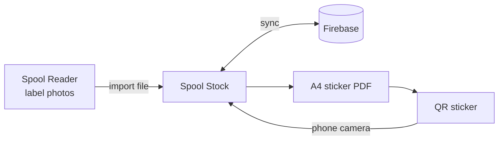

<div align="center">

# Spool Stock

**Scan a sticker, move a spool, always know what filament you own.**

A filament inventory for a home 3D printing setup, with printed QR stickers, phone scanning between storages and offline saving.

[**Open the app**](https://jwilss.github.io/spool-stock/) &nbsp;·&nbsp; [**Download Android and Windows**](https://github.com/jwilss/spool-stock/releases/latest) &nbsp;·&nbsp; [**Setup guide**](SETUP.md) &nbsp;·&nbsp; [**Roadmap**](ROADMAP.md)

<br>

&nbsp;&nbsp;
&nbsp;&nbsp;


</div>

## Stickers that do the work

Add a spool once and the sticker writes itself: logo, material, colour, nozzle, bed and drying settings, plus a QR code that belongs to that spool. Everything prints in black except the colour box, so the only colour on the sticker is the filament's own.


| Filament | Colour box |
|---|---|
| Single colour | Solid fill |
| Multicolour | Split into triangles, one per colour |
| Gradient | Smooth blend of its colours |

Stickers download as an A4 PDF. The app remembers where you got to on a part-used sheet, so no sticker goes to waste.

## What it does

- **Scan to move:** point the camera at a spool, then at a storage. Done. The camera stays on for the next one.
- **See every storage:** AMS slots, dryers and shelves are drawn as racks, with each ring showing the filament's colour and how much is left.
- **Automatic print settings:** type the manufacturer and material and the settings fill in, then get remembered for that filament.
- **Logos saved once:** logos are found or uploaded once, turned solid black on transparent, and stored in your account for every sticker.
- **Works in the shed:** changes save on the device with no signal and sync when you're back.
- **Sensible warnings:** it flags TPU heading for an AMS, a full slot, or a spool that needs more heat than the dryer can give.
- **Low stock at a glance:** weigh a spool and it works out what's left.

## Spool Reader

Photo work lives in a separate tool that runs on Claude. It reads filament labels in batches, identifies unmarked spools against your stock list, and exports a file that Spool Stock imports in one go.

## Use it anywhere

| Where | How |
|---|---|
| Any browser | Open the site |
| Android | Install the APK from Releases |
| Windows | Run the exe from Releases |
| iPhone | Open in Safari, then Share > Add to Home Screen |

All four use the same data. The Android and Windows apps open the live site, so updates reach them without a reinstall.

## How it fits together



| Part | Built with |
|---|---|
| App | One HTML file, no framework |
| Data and sign in | Firebase Firestore and Authentication |
| Hosting | GitHub Pages |
| Android | Capacitor |
| Windows | Electron |
| Stickers | jsPDF and qrcode-generator |
| Scanning | Live camera with jsQR |

## Run your own

You'll need a free GitHub account and a free Firebase project. [SETUP.md](SETUP.md) goes through it step by step, and takes about half an hour.

```
site/        the app
reader/      Spool Reader
wrappers/    Android and Windows shells
docs/        images for this page
test/        end-to-end tests
```

Run the tests with `node test/run.js` and `node test/reader.js`.

## Good to know

- Your stock is private to your account. Firebase's web settings in `site/config.js` are meant to be public, and `firestore.rules` is what protects the data.
- No manufacturer logos are stored in this repo. They live in your private data and belong to their owners. The stickers shown above use made-up brands.
- Print stickers at 100% or Actual size, and test on plain paper first.

<div align="center">
<br>


</div>
