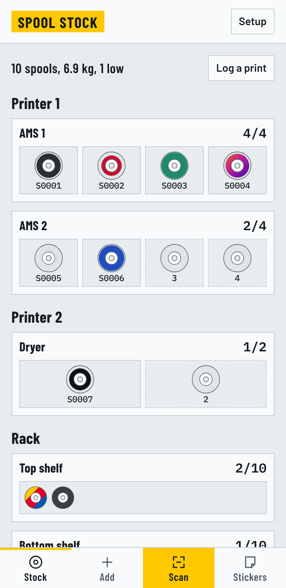
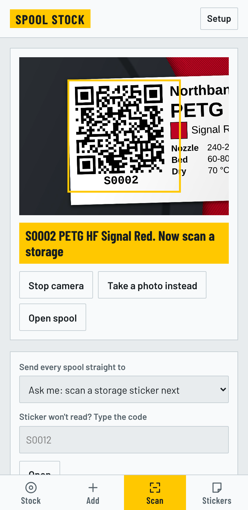
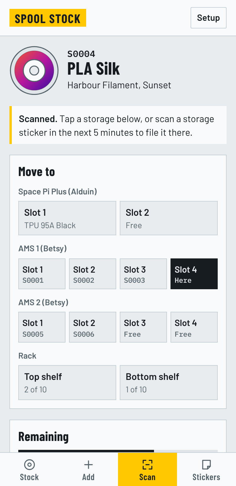
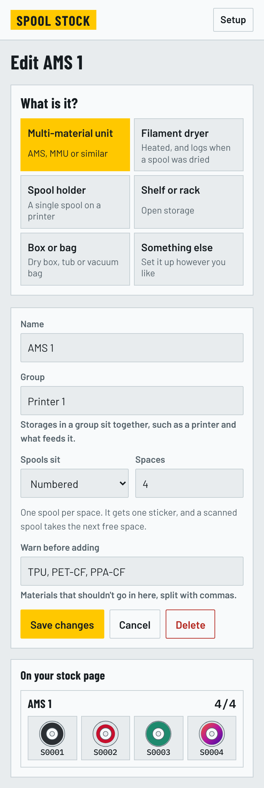
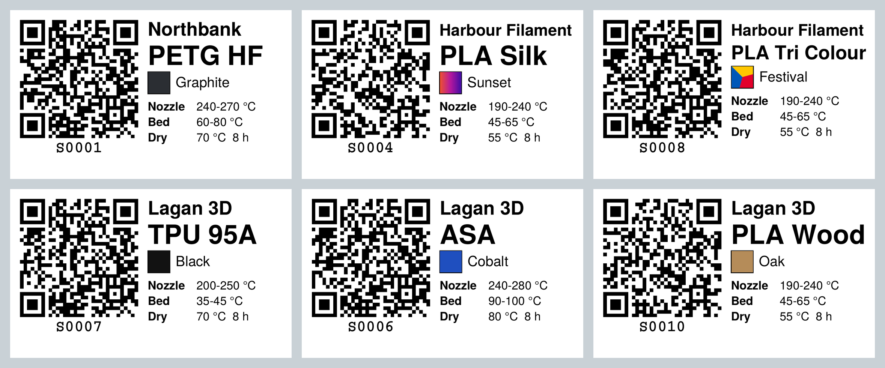
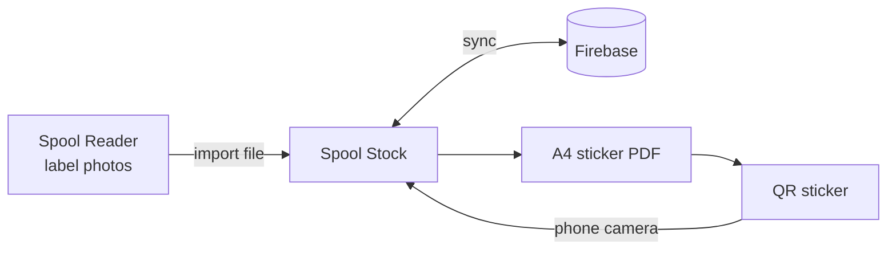

<div align="center">

# Spool Stock

**Scan a sticker, move a spool, always know what filament you own.**

A filament inventory for home 3D printing, with printed QR stickers, phone scanning and offline saving.

[**Open the app**](https://jwilss.github.io/spool-stock/) &nbsp;·&nbsp; [**Download Android and Windows**](https://github.com/jwilss/spool-stock/releases/latest) &nbsp;·&nbsp; [**Setup guide**](SETUP.md) &nbsp;·&nbsp; [**Roadmap**](ROADMAP.md)

<br>

&nbsp;&nbsp;
&nbsp;&nbsp;


</div>

## What it does

- **Scan to move:** point the camera at a spool, then at a storage. The camera stays on for the next one.
- **Storage that matches yours:** add what you actually own, and see it all at a glance with each ring showing the filament's colour and how much is left.
- **Stickers that write themselves:** logo, material, colour, print settings and a QR code, ready to print on A4 sheets.
- **Search your filament:** find a manufacturer, then pick from their own product names, and the settings, spool weight and colours fill in. It covers about 195 manufacturers and 2,200 filaments.
- **Your own names too:** anything that isn't listed can be typed in, and it joins that manufacturer's list with your settings.
- **Works offline:** changes save on the device and sync when you're back online.
- **Low stock at a glance:** weigh a spool and it works out what's left.
- **Log prints from Orca:** drop a sliced file on the app and it takes what each filament used off the right spools.
- **Your filaments in Orca:** Orca's own profile where it has one, a preset with your temperatures where it doesn't, and Orca's list cut down to just your filaments.

## Storage





You start with a blank slate and add each place you keep filament. Choosing a type sets sensible defaults, and everything can be changed afterwards.

| Type | Starts with |
|---|---|
| Multi-material unit | 4 numbered spaces, with a warning for materials that don't suit one |
| Filament dryer | 2 numbered spaces, a top temperature, and a log of when each spool was dried |
| Spool holder | 1 space |
| Shelf or rack | Loose spools with no limit |
| Box or bag | Loose spools with no limit |
| Something else | Whatever you set |

Each storage is one thing with one sticker. A multi-material unit is a single storage with 4 spaces, so a scanned spool takes the next free space. If it's full, the app asks which spool comes out and swaps them.

For each storage you can set:

- Its name and type
- Numbered spaces or loose spools, and how many it holds, so a dryer can have as many slots as yours does
- A top temperature, for dryers
- A group, to keep a printer and everything feeding it together
- Which materials to warn about before they go in
- Where it sits in the list

To change the order spools sit in, open a storage and press **Arrange**, then tap a spool and where it should go. The stock page follows that order.

You can add several of the same at once, and **Remove all storages** in Setup starts you again without touching your spools.

<br clear="right">

## Stickers

Everything prints in black except the colour box, so the only colour on the sticker is the filament's own.



| Filament | Colour box |
|---|---|
| Single colour | Solid fill |
| Multicolour | Split into triangles, one per colour |
| Gradient | Smooth blend of its colours |

Stickers download as an A4 PDF, and the app remembers where you got to on a part-used sheet. Logos are found or uploaded once, turned black on transparent, and stored in your account.

## Logging prints

In Orca, use **Export plate sliced file**, then drop the file on Spool Stock (or press **Log a print** and choose it). Plain G-code works too. It reads the grams each filament used and suggests which spool each came from: same material first, then spools in a unit, holder or dryer, then the nearest colour. Check them, lower the percentage for a failed or cancelled print, and confirm. Each spool keeps a list of its prints, and there's an Undo.

## Orca presets

**Setup > Orca presets** gets every filament you own into OrcaSlicer.

- **Orca already has it** (Bambu PLA Matte, eSUN PETG, SUNLU PLA+ and so on): Orca's own profile is used as it is.
- **Orca doesn't:** a preset is made on Orca's closest generic profile, such as Generic PETG HF or Generic PLA Silk, with the nozzle and bed temperatures on your stickers. These show as "Brand Filament (Spool Stock)".

In the Windows app, close Orca and press **Send to Orca**. It writes the new presets and, with **Only list my filaments in Orca** ticked, sets Orca's filament list to just your filaments. Orca's settings are backed up first, and **Restore Orca's list** puts the old list back.

Without the Windows app, press **Download presets**, then in Orca use **File > Import > Import Configs** and choose the zip, and tick Orca's own ones in its filament list. Setup names them for you.

## Spool Reader

Photo work lives in a separate tool that runs on Claude. It reads filament labels in batches, identifies unmarked spools against your stock list, and exports a file that Spool Stock imports in one go.

## Use it anywhere

| Where | How |
|---|---|
| Any browser | Open the site |
| Android | Install the APK from Releases |
| Windows | Run the exe from Releases |
| iPhone | Open in Safari, then Share > Add to Home Screen |

All four use the same data. The Android and Windows apps open the live site, so updates reach them without a reinstall.

## How it fits together



| Part | Built with |
|---|---|
| App | One HTML file, no framework |
| Data and sign in | Firebase Firestore and Authentication |
| Hosting | GitHub Pages |
| Android | Capacitor |
| Windows | Electron |
| Stickers | jsPDF and qrcode-generator |
| Filament catalogue | SpoolmanDB and the Open Filament Database |
| Scanning | Live camera with jsQR |

## Run your own

You'll need a free GitHub account and a free Firebase project. [SETUP.md](SETUP.md) goes through it step by step, and takes about half an hour. The Firebase key goes in a repository secret, and the publish workflow stops if it's missing.

```
site/        the app
reader/      Spool Reader
tools/       builds the filament catalogue
wrappers/    Android and Windows shells
docs/        images for this page
test/        end-to-end tests
```

Run the tests with `node test/run.js`, `node test/reader.js` and `node test/orca.js`.

## Good to know

- Your stock is private to your account. `firestore.rules` is what protects the data. The Firebase key is kept in a repository secret and added when the site publishes, though browsers still need it, so it can be read on the live site.
- Filament data comes from [SpoolmanDB](https://github.com/Donkie/SpoolmanDB) and the [Open Filament Database](https://github.com/OpenFilamentCollective/open-filament-database), both under the MIT licence, and refreshes each week. It's community data, so check settings against the spool. Drying settings are typical values for the material, apart from a few checked against the manufacturer.
- No manufacturer logos are stored in this repo. They live in your private data and belong to their owners. The stickers shown above use made-up brands.
- Print stickers at 100% or Actual size, and test on plain paper first.
